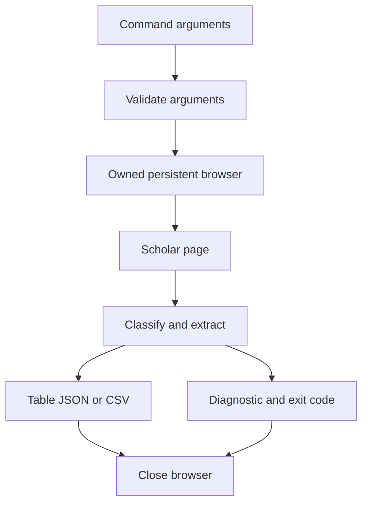
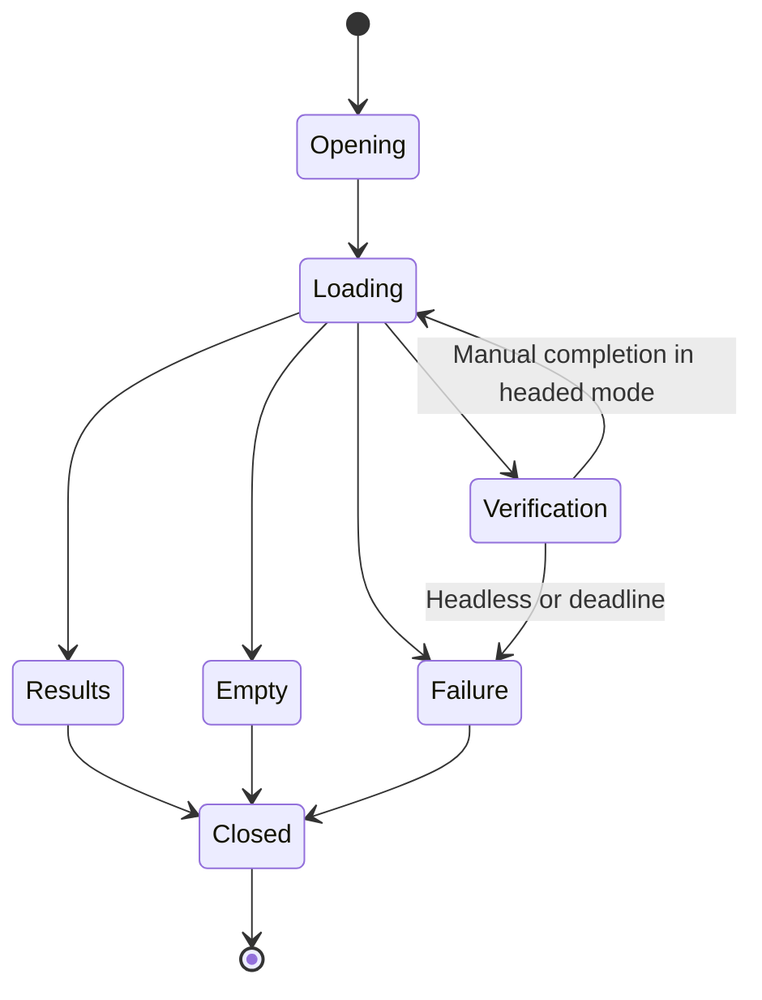

# Build a standalone Scholar CLI - Plan

## Goal capsule

Researchers can search Google Scholar from a terminal through a separately installable `scholar` command.

Means: adapt the OpenCLI search parser and use an independent browser runtime (KTD1).
Authority: the user request and project instructions govern this plan. Implement locally, verify the package, and report the result. Publishing is outside this request.
Stop when required inputs or service access prevent further verification; preserve the completed work and report the specific limit.

## Product contract

### Summary

Create `google-scholar-cli` under Software. Package Google Scholar search as a Node CLI with browser support and structured output.

### Problem frame

The existing search command belongs to the larger OpenCLI application. The user wants to use and maintain Scholar search as its own application.

### Requirements

#### Command and output

- R1. Provide `scholar search <query>`, help, and version through an installable npm package without an OpenCLI runtime dependency.
- R2. Accept a nonblank query and an integer `--limit` from 1 through 20, default 10. Return at most that many results from one Scholar page.
- R3. Preserve the fields `rank`, `title`, `authors`, `source`, `year`, `cited`, and `url`. Rank is numeric; the other fields are strings, matching the source command.
- R4. Support table, JSON, and CSV output via `--format` and `-f`, with `--json` as a shortcut. JSON is an array; CSV has a header. Machine output contains no progress messages.

#### Browser and failure behaviour

- R5. Use a dedicated persistent browser profile. Provide `--headed`, `--browser chromium|chrome`, `--profile`, `--lang`, and `--timeout` in milliseconds; default to Chromium, headless, English, and 30000 ms.
- R6. A recognised empty search succeeds with an empty result set. CAPTCHA, consent pages, rate limits, network failure, and unknown markup return a nonzero exit with useful stderr text.
- R7. Close the owned browser on success, failure, and interruption. A headed verification page can wait for manual completion within the configured timeout; headless verification returns an error immediately.
- R8. Include setup instructions, source attribution, and licence notices. Tests must work without live Google access, and a live smoke check must record its observed outcome.

### Acceptance examples

- AE1. Given a results page with 20 valid papers, a search with `--limit 20 -f json` returns 20 ordered records with the R3 fields. Covers R2, R3, R4.
- AE2. Given an explicit no-results page, JSON output is `[]` with success. A CAPTCHA page instead has a nonzero exit and empty stdout. Covers R6.
- AE3. After a headed user completes verification within the deadline, the search can extract results. Timeout and Ctrl-C close the application-owned browser. Covers R5, R7.

### Scope boundaries

Search is the supported Scholar operation. Author profiles, citation export, PDF downloads, bulk crawling, automatic retries, and CAPTCHA solvers are excluded. They are separate capabilities and are unnecessary for the requested extraction.

The limit is a maximum, not a guarantee that Google returns that many papers. Pagination is excluded because the source command reads one page.

## Planning contract

### Technical decisions

- KTD1. Use Node.js ESM, Commander, and Playwright. Playwright replaces OpenCLI browser management without copying its daemon or extension. Pin dependencies in the lockfile. Supports R1, R5.
- KTD2. Default to Playwright-managed Chromium and require an explicit Chrome choice. Store each browser type in a separate app profile beneath the user cache directory. The Chrome option must never attach to the personal default profile. Supports R5, R7.
- KTD3. Separate DOM extraction from browser control. A browser-evaluated function returns a classified page snapshot and records; HTML fixtures exercise this function in a real Chromium page. Supports R3, R6.
- KTD4. Encode query parameters with URLSearchParams and send `num=<limit>` and `hl=<lang>`. The original adapter truncates records but omits the requested count from its URL. Supports R2.
- KTD5. Treat page recognition as evidence: results, explicit empty state, verification, consent, or unknown. Do not convert missing selectors or timeouts into a successful empty list. Support unlinked citation titles with an empty URL and grouped citation counts. Supports R3, R6.
- KTD6. Use exit codes 0 for success, 2 for invalid arguments, 3 for browser setup/profile errors, 4 for service access or network failure, 5 for unreadable results, and 130 for interruption. Diagnostics use stderr. Supports R4, R6, R7.

### Assumptions

Standalone means independent of OpenCLI and its extension. Node.js and a browser remain installation prerequisites. English is the initial search language; `--lang zh-CN` restores the source language.

The command is used interactively or in small scripts. No request scheduling or bulk search is planned.

### Technical design

### Risks and sources

Google controls the page markup and may block browser automation. Tests can prove local behaviour while live availability remains outside the application's control. Google Scholar help states that bulk access is unavailable and automated software must respect its robots.txt. Document this limit without claiming that a browser session guarantees access.

The installed source is OpenCLI 2.0.2, `clis/google-scholar/search.js`, licensed Apache-2.0. Preserve attribution for the adapted parser and include the licence.

The user supplied these examples during planning. `gscholar` demonstrates citation lookup; `scholarly_publications` separates fetching from JSON output. The Scholar skill uses a `--json` shortcut and keeps metadata tied to fetched records. R4 adopts that shortcut. Citation and author operations remain outside this search extraction. No code from these examples is copied.

- [gscholar](https://github.com/venthur/gscholar)
- [scholarly_publications](https://github.com/ezefranca/scholarly_publications)
- [Scholar skill example](https://mcpmarket.com/tools/skills/google-scholar-search)
- [OpenCLI repository](https://github.com/jackwener/opencli)
- [Playwright persistent browser context](https://playwright.dev/docs/api/class-browsertype#browser-type-launch-persistent-context)
- [Playwright browser installation](https://playwright.dev/docs/browsers)
- [Google Scholar help](https://scholar.google.com/intl/en/scholar/help.html)

## Implementation units

### U1. Package and extract results

Goal: establish the package and parse Scholar pages. Requirements: R1, R2, R3, R6, R8. Dependencies: none.
Files: `package.json`, `package-lock.json`, `.gitignore`, `LICENSE`, `NOTICE`, `src/parser.js`, `src/errors.js`, `test/parser.test.js`, `test/fixtures/*.html`.
Approach: implement KTD1, KTD3, and KTD5 with explicit page states and the existing result field contract. Characterise the parser through fixture-driven browser tests.
Test scenarios:
- Standard and citation-only cards retain titles, metadata, and contiguous ranks.
- Grouped citation counts and absent optional metadata produce defined string values.
- Explicit empty, CAPTCHA, consent, and changed markup remain distinct.
- Unicode queries and encoded punctuation retain their meaning when constructing a search URL.
Verification: deterministic parser fixtures pass in managed Chromium; package metadata has no OpenCLI dependency.

### U2. Own the browser search lifecycle

Goal: search through an independent browser and release it. Requirements: R2, R5, R6, R7. Dependencies: U1.
Files: `src/search.js`, `test/search.test.js`.
Approach: implement KTD2, KTD4, and KTD6. Use one total bounded wait for navigation and page recognition, and allow manual verification only when headed. Browser creation belongs to this module; close it in all terminal paths.
Test scenarios:
- A real browser with intercepted Scholar responses returns records and uses the requested query/count/language.
- Explicit empty, challenge, consent, HTTP 429, timeout, and changed markup have distinct outcomes.
- Browser startup failure and concurrent profile use report actionable errors.
- Cancellation during launch or search eventually closes every created browser context.
Verification: browser integration tests pass without Google access, and no owned process remains after failure.

### U3. Provide the command and formats

Goal: expose the search through the installed executable. Requirements: R1, R2, R4, R5, R6, R7. Dependencies: U2.
Files: `bin/scholar.js`, `src/cli.js`, `src/output.js`, `test/cli.test.js`, `test/output.test.js`.
Approach: connect the command to the search module and map structured errors to KTD6. Escape CSV cells and remove terminal control sequences from human-readable output. Keep machine output lossless.
Test scenarios:
- Help/version do not launch a browser; invalid limits, blank queries, or formats fail before launch.
- JSON parses and CSV preserves quotes, commas, and line breaks.
- The executable produces data-only stdout on success and stderr-only diagnostics on failure.
- A broken output pipe exits without an uncaught stack trace.
Verification: subprocess checks exercise the real bin entry point and formatter tests prove output contracts.

### U4. Document, package, and verify

Goal: make the package usable from another directory. Requirements: R1, R8. Dependencies: U3.
Files: `README.md`, `docs/verification.md`.
Approach: document setup, browser installation, formats, profile ownership, and error recovery. Verify an npm tarball in a fresh temporary directory. Record live search evidence separately from deterministic tests.
Test scenarios:
- A fresh package installation exposes `scholar --help` outside the source directory.
- The packed archive contains runtime code and licence notices and excludes browser profile data.
- One live search returns records or reports the observed service restriction with its defined exit code.
Verification: the documented setup works; all required checks pass or their external limit is recorded with evidence.

## Verification contract

Run `npm test` for deterministic unit and browser integration coverage. Run `npm pack --dry-run` to inspect the archive, then run `npm pack`. Install the produced tarball in a temporary directory and exercise its executable. Run one bounded live Scholar search. Read the final help text and README and run the project writing checker on authored prose. A live block is reported as a limitation, never as a passed live search.

## Definition of done

The `scholar` command runs independently of OpenCLI. U1 through U4 satisfy their verification criteria, and the package includes setup instructions and source notices. Remove temporary experiments from the project. An independent advisor must review the verified working tree before completion is reported.
